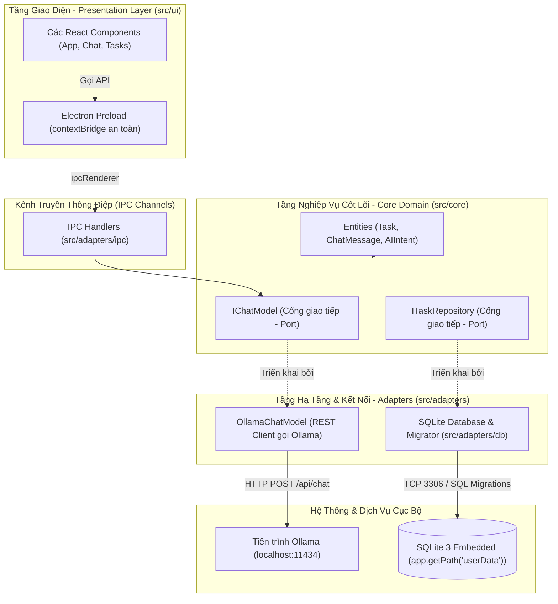

# PVA – Personal Virtual Assistant (Trợ lý ảo cá nhân)

Ứng dụng trợ lý ảo cá nhân chạy trên nền tảng Desktop được xây dựng bằng **Electron**, **React**, **TypeScript**, **SQLite 3 (better-sqlite3)** và **Ollama**. Hệ thống được thiết kế theo mô hình **Kiến trúc Hexagonal (Ports & Adapters)** nhằm đảm bảo tính mô-đun, dễ bảo trì, dễ kiểm thử và tuân thủ định hướng ưu tiên xử lý cục bộ (**Local-first**) bảo vệ quyền riêng tư người dùng.

---

## Mục lục

- [1. Tổng quan dự án](#1-tổng-quan-dự-án)
- [2. Tính năng chính](#2-tính-năng-chính)
- [3. Ngăn xếp công nghệ (Tech Stack)](#3-ngăn-xếp-công-nghệ-tech-stack)
- [4. Kiến trúc hệ thống](#4-kiến-trúc-hệ-thống)
  - [Kiến trúc Hexagonal (Ports & Adapters)](#kiến-trúc-hexagonal-ports--adapters)
  - [Luồng dữ liệu và điều phối](#luồng-dữ-liệu-và-điều-phối)
- [5. Cấu trúc thư mục dự án](#5-cấu-trúc-thư-mục-dự-án)
- [6. Yêu cầu môi trường (Prerequisites)](#6-yêu-cầu-môi-trường-prerequisites)
- [7. Hướng dẫn cài đặt và thiết lập](#7-hướng-dẫn-cài-đặt-và-thiết-lập)
- [8. Các lệnh phát triển (Scripts)](#8-các-lệnh-phát-triển-scripts)
- [9. Đóng gói ứng dụng (Build & Packaging)](#9-đóng-gói-ứng-dụng-build--packaging)
- [10. Cấu hình hệ thống](#10-cấu-hình-hệ-thống)
- [11. Trạng thái phát triển](#11-trạng-thái-phát-triển)
- [12. Lộ trình phát triển (Roadmap)](#12-lộ-trình-phát-triển-roadmap)

---

## 1. Tổng quan dự án

**PVA (Personal Virtual Assistant)** là ứng dụng trợ lý ảo cá nhân trên máy tính cá nhân, ưu tiên hệ điều hành Windows (đồng thời hỗ trợ cấu hình đóng gói đa nền tảng cho macOS và Linux). Ứng dụng vận hành theo nguyên tắc **xử lý dữ liệu cục bộ** nhằm đảm bảo an toàn thông tin cá nhân và không phụ thuộc vào các dịch vụ AI đám mây tính phí.

Các điểm nổi bật về mặt kỹ thuật:

- **Xử lý AI cục bộ (Local-first AI):** Tích hợp trực tiếp với runtime Ollama thông qua REST API cục bộ, dữ liệu hội thoại không bị gửi ra ngoài Internet.
- **Cơ sở dữ liệu nhúng cục bộ (Embedded SQLite):** Sử dụng SQLite 3 nhúng qua `better-sqlite3` (`PRAGMA foreign_keys = ON`, `WAL` mode, tìm kiếm toàn văn `FTS5`), tự động lưu trữ tại thư mục an toàn của hệ điều hành (`app.getPath('userData')/pva.sqlite`). Hoàn toàn không yêu cầu người dùng phải cài đặt hay cấu hình máy chủ MySQL bên ngoài.
- **Kiến trúc Hexagonal độc lập:** Tách biệt hoàn toàn giữa Tầng nghiệp vụ cốt lõi (`src/core`), Tầng điều phối hạ tầng bên ngoài (`src/adapters`) và Tầng giao diện người dùng (`src/ui`).
- **Hệ thống build tốc độ cao:** Sử dụng `electron-vite` (Vite 8 + React 19) mang lại trải nghiệm Hot Module Replacement (HMR) tức thì và tối ưu hóa dung lượng bundle khi xuất bản.
- **Phân tách tiến trình an toàn:** Giao tiếp giữa Main Process và Renderer Process được kiểm soát chặt chẽ qua cơ chế IPC an toàn thông qua `contextBridge` trong script Preload.

---

## 2. Tính năng chính

### Đã hoàn thành và xác minh thực tế

- **Khung ứng dụng Desktop (Shell):** Quản lý vòng đời cửa sổ Electron, cấu hình sandbox an toàn, tự động nhận diện phím tắt DevTools khi phát triển.
- **Hợp đồng miền nghiệp vụ Hexagonal:**
  - Cổng giao tiếp `ChatModel` (`src/core/ports/ChatModel.ts`) định nghĩa hợp đồng kiểm tra kết nối (`health`), sinh phản hồi (`complete`) và phản hồi theo luồng (`stream`). Hoàn toàn độc lập với các thư viện bên ngoài.
  - Các thực thể dữ liệu chuẩn hóa: `ChatMessage`, `ModelError`, `Task` (chuẩn hóa `TaskStatus = 'open' | 'done'` đồng bộ với SQLite constraint) và `AIIntent` (`NormalizedAIResponse`).
  - Dịch vụ miền `ChatService`: Đảm nhận xác thực tin nhắn người dùng, loại bỏ tin nhắn rỗng/khoảng trắng, điều phối lời gọi đến `ChatModel`.
- **Adapter tích hợp mô hình AI Ollama (`OllamaChatModel`):**
  - Adapter giao tiếp HTTP qua API gốc của Ollama (`/api/version`, `/api/tags`, `/api/chat`) bằng `fetch` native của Node.js.
  - Kiểm soát timeout an toàn bằng `AbortSignal.timeout`.
  - Hỗ trợ mô hình mặc định (`qwen3:1.7b` chạy trực tiếp trên CPU qua AVX2 để phản hồi tức thì trong quá trình thử nghiệm, sẵn sàng nâng cấp lên `qwen3:4b`) và tham số sinh (`temperature`).
  - Tự động tách và làm sạch thẻ suy nghĩ reasoning (`<think>...</think>`), đảm bảo câu trả lời hiển thị gọn gàng.
  - Chuẩn hóa hệ thống mã lỗi nghiêm ngặt: `MODEL_UNAVAILABLE`, `MODEL_TIMEOUT`, `MODEL_BAD_RESPONSE`.
- **Lưu trữ hội thoại dạng Transactional & Khôi phục lịch sử (SRS v2.1):**
  - Tích hợp `ConversationRepository` và `SqliteConversationRepository` lưu cặp tin nhắn User và Assistant vào SQLite bên trong transaction nguyên tử.
  - Công tắc bật/tắt lưu lịch sử trò chuyện (Persistence Toggle) trực tiếp trên Header.
  - Tự động khôi phục lịch sử hội thoại khi khởi động lại ứng dụng.
- **Ngữ cảnh đa lượt & Tắt chế độ suy nghĩ (FR-01):**
  - Quản lý cửa sổ trượt 10 lượt gần nhất (20 tin nhắn) gửi kèm `DEFAULT_SYSTEM_PROMPT` tiếng Việt.
  - Cấu hình `think: false` gửi trực tiếp tới Ollama `/api/chat` giúp loại bỏ hoàn toàn các thẻ `<think>` của Qwen3 và phản hồi nhanh tức thì.
- **Giao diện hội thoại phong cách Facebook Messenger:**
  - Thiết kế bong bóng tin nhắn co dãn ôm sát nội dung (`width: fit-content; max-width: 72%`), loại bỏ nhãn tiêu đề "Bạn/PVA".
  - Thời gian gửi hiển thị tương tác khi người dùng bấm vào bong bóng tin nhắn.
  - Thay avatar PVA bằng hình ảnh chính thức tại `resources/ava.jpg`.
  - Tối giản Header: tự động ẩn trạng thái "Ollama sẵn sàng" khi kết nối tốt và ẩn nhãn model `qwen3.1`.
- **Tầng giao tiếp liên tiến trình an toàn (IPC & Preload):**
  - Đăng ký các kênh IPC trong Main Process: `chat:send` (gửi tin nhắn) và `chat:health` (kiểm tra trạng thái Ollama) kèm kiểm tra xác thực dữ liệu đầu vào.
  - Bắt lỗi an toàn tại IPC Adapter, không bao giờ để lộ raw error hay exception stack trace ra ngoài Renderer.
  - Cấu hình Electron an toàn: `sandbox: true`, `contextIsolation: true`, `nodeIntegration: false`.
  - Cầu nối Preload an toàn: Định nghĩa Single Source of Truth tại `src/preload/types.ts`. Expose duy nhất đối tượng `window.api.chat` qua `contextBridge`, tuyệt đối không để lộ `ipcRenderer` thô.
- **Giao diện người dùng hội thoại (Chat UI) & Apple Liquid Glass:**
  - Xây dựng bằng React 19 với hệ thống **Design Tokens** tập trung ([`tokens.css`](src/ui/src/assets/tokens.css)) theo phong cách **Apple Liquid Glass**.
  - Hỗ trợ đa giao diện (Dark Theme / Light Theme) với nút chuyển đổi nhanh trên Header.
  - Hiển thị danh sách bong bóng hội thoại giữa người dùng và trợ lý ảo PVA kèm mốc thời gian.
  - Trạng thái loading thời gian thực ("PVA đang suy nghĩ...") và biểu tượng xoay trực quan.
  - Thanh thông báo lỗi (Error Banner) hiển thị chi tiết mã lỗi chuẩn hóa khi mất kết nối hoặc timeout.
  - Huy hiệu (badge) kiểm tra trạng thái kết nối Ollama theo thời gian thực (Xanh: Sẵn sàng, Vàng: Đang kiểm tra, Đỏ: Ngoại tuyến).
  - Tích hợp các câu hỏi gợi ý nhanh và phím tắt thông minh (`Enter` để gửi, `Shift + Enter` để xuống dòng).
- **Thiết lập Database SQLite Embedded & Migration 001 (SRS v2.1):**
  - Schema khởi tạo [`migrations/001_initial_schema.sql`](migrations/001_initial_schema.sql) gồm 7 bảng chuẩn SQLite + bảng ảo tìm kiếm toàn văn `messages_fts` (FTS5): `conversations`, `messages`, `messages_fts`, `tasks` (kèm trigger cập nhật `updated_at`), `reminders`, `settings`, `profile_items` và `schema_migrations`.
  - Bộ quản lý Database [`src/adapters/db/database.ts`](src/adapters/db/database.ts) tự động tạo file SQLite tại `app.getPath('userData')`, kích hoạt `PRAGMA foreign_keys = ON` và chế độ `WAL`.
  - Bộ chạy migration tự động theo thứ tự đánh số ([`src/adapters/db/migrator.ts`](src/adapters/db/migrator.ts)) bọc trong transaction nguyên tử, tự động chạy khi ứng dụng khởi động và đóng kết nối an toàn khi ứng dụng thoát.
- **Cấu hình Path Aliasing & Định dạng mã nguồn:** Import mã nguồn sạch sẽ qua `@core`, `@adapters`, `@ui`, `@renderer`. Toàn bộ mã nguồn tuân thủ nghiêm ngặt ESLint và Prettier.

### Đang phát triển

- **Lưu lịch sử hội thoại vào Database:** Sử dụng SQLite nhúng lưu `conversations` và `messages` theo transaction.
- **Quản lý công việc (Task Management):** Các thành phần giao diện xem, thêm và cập nhật trạng thái công việc.

### Dự kiến triển khai theo lộ trình

- **Tầng Repository SQLite:** Triển khai `SqliteTaskRepo`, `SqliteConversationRepo` trong `src/adapters/db`.
- **Bộ chuẩn hóa và trích xuất Intent:** Tinh chỉnh System Prompt tiếng Việt và bộ định tuyến lệnh (`RuleRouter` / `IntentRouter`).
- **Hiển thị Avatar 3D:** Tích hợp Three.js / VRM hiển thị hoạt cảnh nhân vật 3D.
- **Nhận dạng và tổng hợp giọng nói:** Tích hợp STT ngoại tuyến (Whisper.cpp) và TTS (Piper / Microsoft An).

---

## 3. Ngăn xếp công nghệ (Tech Stack)

| Phân tầng                | Công nghệ                                                                                                    | Chi tiết phiên bản & Vai trò                                                               |
| :----------------------- | :----------------------------------------------------------------------------------------------------------- | :----------------------------------------------------------------------------------------- |
| **Desktop Shell**        | [Electron](https://www.electronjs.org/) `^44.7.2`                                                            | Quản lý tiến trình nền, cửa sổ và tích hợp hệ điều hành                                    |
| **Hệ thống Build**       | [electron-vite](https://electron-vite.org/) `^6.0.0` / [Vite](https://vite.dev/) `^8.3.4`                    | Bộ công cụ build chuyên biệt cho Main, Preload và Renderer                                 |
| **Giao diện (Frontend)** | [React](https://react.dev/) `^19.3.0`                                                                        | Thư viện UI hiện đại chạy ở chế độ StrictMode                                              |
| **Ngôn ngữ**             | [TypeScript](https://www.typescriptlang.org/) `^5.9.3`                                                       | Định kiểu dữ liệu tĩnh đồng nhất cho toàn bộ dự án                                         |
| **Mô hình AI cục bộ**    | [Ollama](https://ollama.com/)                                                                                | Runtime chạy mô hình ngôn ngữ mã nguồn mở (`http://localhost:11434`)                       |
| **Cơ sở dữ liệu**        | [SQLite 3](https://www.sqlite.org/) ([better-sqlite3](https://github.com/WiseLibs/better-sqlite3) `^13.0.3`) | CSDL nhúng cục bộ (`WAL` mode, `PRAGMA foreign_keys = ON`, `FTS5`), không cần server ngoài |
| **Đóng gói phân phối**   | [electron-builder](https://www.electron.build/) `^26.15.3`                                                   | Tạo bộ cài đặt Windows (NSIS .exe), macOS (.dmg), Linux                                    |
| **Chuẩn hóa mã nguồn**   | ESLint `^9.39` + Prettier `^3.9`                                                                             | Kiểm tra cú pháp và định dạng code tự động                                                 |

---

## 4. Kiến trúc hệ thống

Dự án áp dụng mô hình **Kiến trúc Hexagonal (Ports & Adapters)** để đảm bảo rằng logic nghiệp vụ trung tâm không bị phụ thuộc vào các thư viện giao diện, trình điều khiển database hay nhà cung cấp AI cụ thể.



### Trách nhiệm của các phân vùng

1. **`src/core/` (Nghiệp vụ cốt lõi - Domain Logic):**
   - **`ports/`**: Chứa các Interface định nghĩa hợp đồng nghiệp vụ (ví dụ: `IChatModel.ts`). Tuyệt đối không import thư viện React, Electron hay Database.
   - **`models/`**: Chứa các cấu trúc dữ liệu và thực thể nghiệp vụ (`ChatMessage.ts`, `Task.ts`, `AIIntent.ts`).
   - **`services/`**: Chứa các use case xử lý logic thuần túy.

2. **`src/adapters/` (Hạ tầng - Infrastructure):**
   - **`ai/`**: Lớp cài đặt cụ thể cho cổng AI (`OllamaChatModel.ts` giao tiếp qua HTTP với Ollama).
   - **`ipc/`**: Lớp lắng nghe sự kiện IPC từ giao diện gửi tới Main Process (`chat.ipc.ts`).
   - **`db/`**: Bộ quản lý kết nối SQLite nhúng [`database.ts`](src/adapters/db/database.ts) và bộ chạy migration tự động theo transaction [`migrator.ts`](src/adapters/db/migrator.ts).

3. **`src/ui/` (Giao diện hiển thị - Presentation):**
   - Ánh xạ từ tiến trình Renderer của Electron.
   - Chứa toàn bộ component React 19, CSS và hooks.
   - Giao tiếp với tầng dưới duy nhất thông qua `window.api.chat` được bảo vệ bởi Preload.

4. **`migrations/` & `scripts/`:**
   - **`migrations/`**: Chứa các file SQL đánh số thứ tự (`001_initial_schema.sql`, ...) tương thích hoàn toàn SQLite 3 / better-sqlite3.
   - **`scripts/`**: Chứa kịch bản kiểm thử tích hợp thực tế (`test_chat_integration.ts`).

---

## 5. Cấu trúc thư mục dự án

```text
.
├── migrations/                         # Các file SQL migration đánh số thứ tự
│   └── 001_initial_schema.sql          # Migration 001 tạo 7 bảng chuẩn SRS v2.1
├── resources/                          # Tài nguyên tĩnh không qua đóng gói của Vite
│   └── icon.png                        # Icon ứng dụng
├── scripts/                            # Công cụ hỗ trợ kiểm thử & vận hành
│   └── test_chat_integration.ts        # Kịch bản kiểm thử tích hợp thực tế với Ollama
├── src/
│   ├── main/                           # Tiến trình Main của Electron
│   │   └── index.ts                    # Khởi tạo BrowserWindow, Database và đăng ký IPC
│   ├── preload/                        # Script Preload kết nối an toàn
│   │   ├── index.ts                    # Cấu hình contextBridge cho Renderer
│   │   ├── index.d.ts                  # Khai báo toàn cục Window.api
│   │   └── types.ts                    # Single Source of Truth cho Preload API contracts
│   ├── core/                           # Tầng nghiệp vụ cốt lõi (Hexagonal Core)
│   │   ├── models/
│   │   │   ├── AIIntent.ts             # Kiểu dữ liệu ý định & NormalizedAIResponse
│   │   │   ├── ChatMessage.ts          # Cấu trúc tin nhắn hội thoại
│   │   │   ├── ModelError.ts           # Định nghĩa mã lỗi chuẩn hóa
│   │   │   ├── Task.ts                 # Thực thể công việc (Task, TaskStatus = 'open' | 'done')
│   │   │   └── Task.test.ts            # Unit test cho Task & TaskStatus
│   │   ├── ports/
│   │   │   └── ChatModel.ts            # Cổng giao tiếp mô hình (Port abstraction)
│   │   └── services/                   # Dịch vụ nghiệp vụ (ChatService)
│   ├── adapters/                       # Tầng kết nối công nghệ ngoài (Adapters)
│   │   ├── ai/
│   │   │   └── OllamaChatModel.ts      # Triển khai ChatModel qua API Ollama
│   │   ├── db/
│   │   │   ├── database.ts             # Quản lý kết nối SQLite nhúng (better-sqlite3)
│   │   │   ├── database.test.ts        # Bộ unit test toàn diện cho SQLite và Migrator
│   │   │   └── migrator.ts             # Bộ chạy migration kiểm tra bảng schema_migrations
│   │   └── ipc/
│   │       └── chat.ipc.ts             # Lắng nghe và xử lý sự kiện IPC về AI
│   └── ui/                             # Tầng giao diện người dùng (React + Vite)
│       ├── index.html                  # File HTML chính của giao diện
│       └── src/
│           ├── assets/                 # Design Tokens (tokens.css), base.css, main.css
│           ├── components/             # Các React Component tái sử dụng
│           ├── App.tsx                 # Component gốc của ứng dụng
│           ├── env.d.ts                # Định kiểu môi trường Vite
│           └── main.tsx                # Điểm gắn kết React vào DOM
├── .env.example                        # File mẫu cấu hình biến môi trường kết nối MySQL
├── electron-builder.yml                # Cấu hình đóng gói bộ cài đặt ứng dụng
├── electron.vite.config.ts             # Cấu hình Vite cho Main, Preload và UI
├── eslint.config.mjs                   # Cấu hình kiểm tra chuẩn code ESLint
├── package.json                        # Khai báo dependencies và script thực thi
├── tsconfig.json                       # File tham chiếu TypeScript gốc
├── tsconfig.node.json                  # Cấu hình TypeScript cho Main, Preload, Core, Adapters
└── tsconfig.web.json                   # Cấu hình TypeScript cho UI (React)
```

---

## 6. Yêu cầu môi trường (Prerequisites)

Để phát triển và chạy ứng dụng, môi trường cần đáp ứng:

- **Node.js**: Phiên bản `v20+` (đã xác minh trên Node.js `v24.11.1`).
- **npm**: Phiên bản `v10+` (đã xác minh trên `11.6.2`).
- **SQLite 3**: Đã tích hợp sẵn qua thư viện nhúng `better-sqlite3`, **hoàn toàn không cần cài đặt thêm bất kỳ phần mềm Database nào**.
- **Ollama**: Đã cài đặt và đang hoạt động trên máy tính:
  - Tải về từ trang chủ: [ollama.com](https://ollama.com)
  - Đảm bảo service Ollama đang lắng nghe tại cổng `http://localhost:11434`.
  - Tải các mô hình thử nghiệm theo lộ trình:
    ```bash
    ollama pull qwen3:1.7b
    ```

---

## 7. Hướng dẫn cài đặt và thiết lập

1. **Di chuyển vào thư mục gốc của dự án:**

   ```powershell
   cd PVA
   ```

2. **Cài đặt các gói phụ thuộc:**

   ```powershell
   npm install
   ```

3. **Cơ sở dữ liệu tự động khởi tạo:**
   - Ứng dụng tự động tạo file Database tại `app.getPath('userData')/pva.sqlite` và thực thi toàn bộ migration ngay khi khởi động.
   - Không cần thiết lập máy chủ hay tài khoản Database thủ công.

4. **Khởi động và kiểm tra Ollama:**

   ```powershell
   ollama serve
   ollama list
   ```

5. **Kiểm tra chất lượng mã nguồn và kiểm thử tự động:**
   ```powershell
   npm run build:check
   npm test
   ```

---

## 8. Các lệnh phát triển (Scripts)

Tất cả các lệnh đều được chạy từ **thư mục gốc của dự án** qua cú pháp `npm run <lệnh>`:

| Lệnh                     | Ý nghĩa chức năng                                                                                          |
| :----------------------- | :--------------------------------------------------------------------------------------------------------- |
| `npm run dev`            | Khởi chạy máy chủ phát triển Vite với tính năng HMR và mở cửa sổ ứng dụng Electron.                        |
| `npm run typecheck`      | Chạy kiểm tra kiểu TypeScript trên cả môi trường Node (`tsconfig.node.json`) và Web (`tsconfig.web.json`). |
| `npm run typecheck:node` | Kiểm tra kiểu riêng cho Main, Preload, Core và Adapters.                                                   |
| `npm run typecheck:web`  | Kiểm tra kiểu riêng cho các thành phần giao diện React.                                                    |
| `npm run lint`           | Chạy bộ kiểm tra lỗi cú pháp và quy tắc định dạng mã nguồn bằng ESLint.                                    |
| `npm run build:check`    | Chạy kết hợp `npm run lint` và `npm run typecheck`.                                                        |
| `npm run build`          | Chạy typecheck và đóng gói các bundle hoàn chỉnh cho Main, Preload và UI.                                  |
| `npm run start`          | Xem trước bản build đã đóng gói bằng lệnh `electron-vite preview`.                                         |
| `npm run format`         | Định dạng lại toàn bộ code tự động theo cấu hình Prettier.                                                 |

---

## 9. Đóng gói ứng dụng (Build & Packaging)

Ứng dụng được đóng gói thành các tệp thực thi phân phối thông qua `electron-builder`:

```powershell
# Đóng gói ra thư mục giải nén (để kiểm tra nhanh binary mà không cần cài đặt)
npm run build:unpack

# Đóng gói bộ cài đặt cho Windows (file setup .exe qua NSIS)
npm run build:win

# Đóng gói cho macOS (.dmg)
npm run build:mac

# Đóng gói cho Linux (.AppImage, .deb, .snap)
npm run build:linux
```

Các file sau khi đóng gói sẽ được tạo ra tại thư mục `dist/`.

---

## 10. Cấu hình hệ thống

### Cấu hình Cơ sở dữ liệu SQLite

Ứng dụng sử dụng cơ chế lưu trữ tự quản (Zero-configuration):

- **Vị trí lưu mặc định:** `%APPDATA%\pva-desktop\pva.sqlite` (Windows) hoặc theo thư mục `app.getPath('userData')`.
- **Ghi đè đường dẫn khi dev/test (tùy chọn):** Có thể đặt biến môi trường `PVA_DB_PATH` trong file `.env` nếu muốn trỏ file database sang thư mục tùy ý.
- **Tính năng SQLite:** Tự động bật `PRAGMA foreign_keys = ON`, `PRAGMA journal_mode = WAL` và `FTS5` fulltext search.

### Cấu hình mô hình AI

Được thiết lập bên trong [`src/adapters/ai/OllamaChatModel.ts`](src/adapters/ai/OllamaChatModel.ts):

- **Địa chỉ API mặc định**: `http://localhost:11434`
- **Tên mô hình mặc định**: `qwen3:1.7b` (mô hình thử nghiệm siêu nhẹ, sẵn sàng nâng cấp lên `qwen3:4b` khi cần)
- **Độ sáng tạo (Temperature)**: `0.3`
- **Thời gian chờ (Timeout)**: 4.000 ms cho kiểm tra trạng thái (`health`), 60.000 ms cho suy luận hoàn chỉnh (`complete`).

### Cấu hình Path Alias

Được thiết lập thống nhất tại [`electron.vite.config.ts`](electron.vite.config.ts), [`tsconfig.node.json`](tsconfig.node.json), và [`tsconfig.web.json`](tsconfig.web.json):

- `@core/*` ➔ `src/core/*`
- `@adapters/*` ➔ `src/adapters/*`
- `@ui/*` ➔ `src/ui/src/*`
- `@renderer/*` ➔ `src/ui/src/*`

---

## 11. Trạng thái phát triển

### Danh mục kiểm tra tiến độ

- [x] **Khởi tạo và cấu trúc dự án**
  - [x] Template chuẩn Electron + React 19 + TypeScript.
  - [x] Cấu hình `electron-vite` nhận diện đúng thư mục giao diện `src/ui`.
  - [x] Kiểm tra ESLint và Typecheck thành công với 0 lỗi.
- [x] **Nền tảng kiến trúc Hexagonal**
  - [x] Tạo các mô hình và interface nghiệp vụ trong `src/core`.
  - [x] Tạo các adapter kết nối ngoại vi trong `src/adapters`.
- [x] **Thiết lập Database SQLite Embedded & Migration 001**
  - [x] Xây dựng [`migrations/001_initial_schema.sql`](migrations/001_initial_schema.sql) tạo đủ 7 bảng chuẩn SRS v2.1 + bảng ảo FTS5 (`conversations`, `messages`, `messages_fts`, `tasks`, `reminders`, `settings`, `profile_items`, `schema_migrations`).
  - [x] Triển khai bộ quản lý SQLite [`src/adapters/db/database.ts`](src/adapters/db/database.ts) với `better-sqlite3`, `WAL` mode và `PRAGMA foreign_keys = ON`.
  - [x] Triển khai bộ chạy migration theo transaction [`src/adapters/db/migrator.ts`](src/adapters/db/migrator.ts).
  - [x] Bộ unit test SQLite toàn diện [`src/adapters/db/database.test.ts`](src/adapters/db/database.test.ts) đạt 100% (9 tests pass).
  - [x] Loại bỏ hoàn toàn sự phụ thuộc vào MySQL Server bên ngoài.
- [x] **Tầng tích hợp AI cục bộ & Luồng Chat (Nhiệm vụ 5 - Tuần 1)**
  - [x] Khai báo Port `ChatModel` (`IChatModel`) hoàn toàn độc lập với công nghệ ngoài.
  - [x] Triển khai Domain Service `ChatService` kiểm tra hợp lệ dữ liệu.
  - [x] Triển khai Adapter `OllamaChatModel` gọi REST API Ollama, xử lý reasoning tags và chuẩn hóa mã lỗi (`MODEL_UNAVAILABLE`, `MODEL_TIMEOUT`, `MODEL_BAD_RESPONSE`).
  - [x] Đăng ký kênh IPC an toàn `chat:send` và `chat:health` trong Main Process.
  - [x] Cầu nối Preload an toàn qua `contextBridge` (`window.api.chat`).
- [x] **Tầng giao diện người dùng (UI Layer - Hoàn thành giao diện Chat)**
  - [x] Giao diện hội thoại tương tác thời gian thực với trợ lý ảo PVA (React 19 + TypeScript).
  - [x] Bong bóng tin nhắn phong cách Facebook Messenger: co dãn ôm trọn nội dung, ẩn nhãn Bạn/PVA, click xem timestamp.
  - [x] Cập nhật avatar đại diện PVA từ `resources/ava.jpg`.
  - [x] Tối giản Header: tự động ẩn trạng thái khi sẵn sàng và ẩn tag model.
  - [x] Công tắc bật/tắt lưu lịch sử (Persistence Toggle) trực quan.
- [x] **Lưu trữ hội thoại CSDL & Ngữ cảnh đa lượt (FR-01)**
  - [x] Duy trì cửa sổ trượt 10 lượt hội thoại gần nhất kèm System Prompt tiếng Việt.
  - [x] Tắt thẻ suy nghĩ `think: false` trực tiếp trong request payload của Ollama.
  - [x] Triển khai `SqliteConversationRepository` lưu cặp tin nhắn trong SQLite Transaction nguyên tử.
  - [x] Tự động tải lại lịch sử hội thoại khi ứng dụng khởi động lại.
  - [x] Kiểm thử tự động đạt chuẩn 3 lượt hội thoại liên tiếp (FR-01).
- [ ] **Quản lý công việc (Task Management)**
  - [ ] Bảng theo dõi và quản lý công việc (Todo List).
  - [ ] Triển khai các Repository SQLite lưu `tasks` và `reminders`.

---

## 12. Lộ trình phát triển (Roadmap)

1. **Mốc M1 (Tuần 1–2): Hoàn thiện luồng Chat và Lưu lịch sử hội thoại**
   - Kết nối giao diện React với kênh IPC `ai:send-message` và hiển thị phản hồi dạng streaming.
   - Lưu trữ `conversations` và `messages` vào SQLite Embedded trong transaction.

2. **Mốc M2 & M3 (Tuần 3–5): Quản lý công việc, Nhắc nhở, Hồ sơ và Quyền thao tác**
   - Triển khai `TaskService`, `MySqlTaskRepo`, `ReminderService` và `InAppScheduler`.
   - Xây dựng `RuleRouter`, `PermissionGuard` và quản lý `allowlist.json`.

3. **Mốc M4 & M5 (Tuần 6–8): Giọng nói, Avatar 3D, Kiểm thử và Đóng gói MVP**
   - Tích hợp STT (Whisper.cpp), TTS (Piper / Microsoft An) và Avatar VRM 4 trạng thái.
   - Hoàn thiện màn hình thiết lập lần đầu (FR-15) và đóng gói bộ cài NSIS `.exe`.

---

## Giấy phép (License)

Dự án được phân phối theo giấy phép mã nguồn mở MIT.
