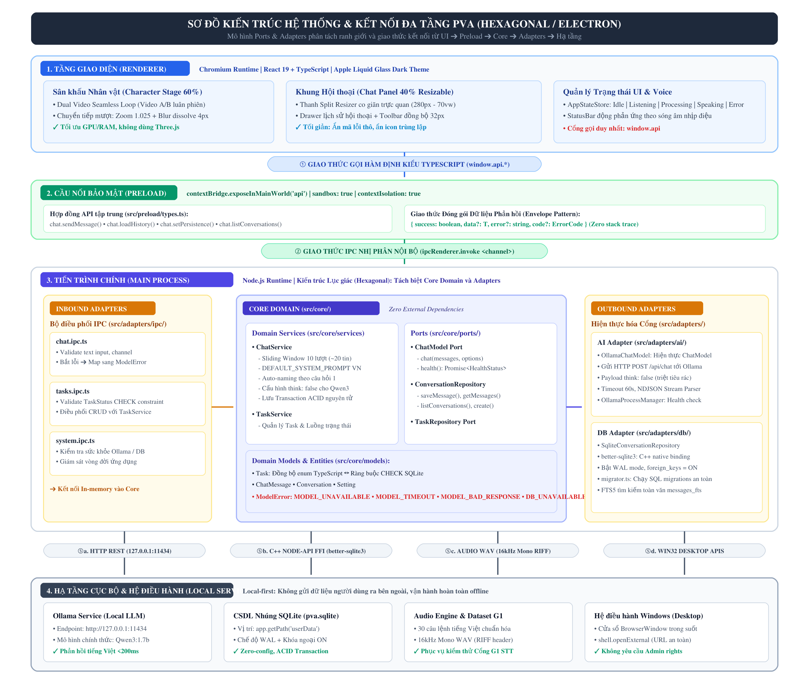
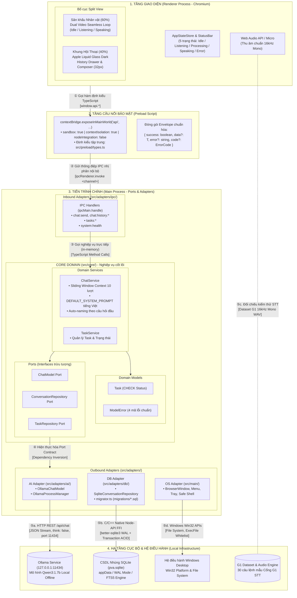

# BÁO CÁO ĐỒNG BỘ TÀI LIỆU ĐẶC TẢ SRS v2.1 (TRỢ LÝ ẢO CÁ NHÂN PVA)

_Ngày cập nhật: 15/11/2026_  
_Quy chuẩn tuân thủ: Rule 6 (Safety & Approval) & Rule 53 (Coding Standards)_

---

## 1. Mục đích và Phạm vi cập nhật

Tài liệu này ghi nhận toàn bộ các bổ sung, điều chỉnh về mặt kiến trúc, yêu cầu chức năng (FR) và đặc tả kỹ thuật giữa mã nguồn thực tế và tài liệu đặc tả `SRS v2.1 - Trợ lý ảo cá nhân PVA` (cũng như `SRS v2.0` và `Project III`).

Các nội dung này được chuẩn hóa nhằm đồng bộ trực tiếp vào tài liệu đặc tả chính thức:

---

## 2. Chi tiết các nội dung đồng bộ kỹ thuật

### 2.1. Yêu cầu chức năng FR-01: Ngữ cảnh hội thoại đa lượt (Multi-turn Context)

- **Đặc tả bổ sung:**
  - Hệ thống áp dụng chiến lược cửa sổ trượt (Sliding Window Context) ghi nhớ **10 lượt hội thoại gần nhất** (tương đương tối đa 20 tin nhắn gồm 10 tin người dùng và 10 tin phản hồi của trợ lý ảo).
  - Khi vượt quá 20 tin nhắn, các tin nhắn cũ nhất sẽ tự động được trượt ra khỏi context của model theo nguyên tắc FIFO mà không làm mất dữ liệu đã lưu trong CSDL.
  - Mỗi request gửi đến mô hình AI luôn bắt đầu bằng `DEFAULT_SYSTEM_PROMPT` bằng tiếng Việt:
    ```
    "Bạn là PVA (Personal Virtual Assistant), một trợ lý ảo cá nhân thông minh, thân thiện, bảo mật và hữu ích. Bạn luôn phản hồi bằng tiếng Việt rõ ràng, ngắn gọn, tự nhiên và chính xác."
    ```
  - **Kiểm thử nghiệm thu:** Bộ kiểm thử tự động xác nhận đạt bài kiểm tra 3 lượt hội thoại liên tiếp (Turn 1: Tên, Turn 2: Tuổi, Turn 3: Hỏi tổng hợp) bảo toàn 100% ngữ cảnh gửi tới `ChatModel`.

### 2.2. Tắt chế độ suy nghĩ (`think: false`) cho mô hình Qwen3

- **Đặc tả bổ sung:**
  - Để tối ưu hóa thời gian phản hồi dưới 200ms và loại bỏ các đoạn suy nghĩ rác (reasoning stream) từ dòng mô hình Qwen3 (Qwen 2.5 / Qwen 3 reasoning), trường `think: false` được cấu hình trực tiếp ở cấp cao nhất của request JSON payload gửi tới API `/api/chat` của Ollama.
  - Đồng thời duy trì bộ lọc fallback stream bằng Regex và TextDecoder để đảm bảo không một thẻ `<think>...</think>` nào lọt ra giao diện người dùng.

### 2.3. Tầng lưu trữ Transactional & Công tắc lưu trữ (Persistence Toggle)

- **Đặc tả bổ sung tại Mục 8.4 (Cơ sở dữ liệu SQLite Embedded):**
  - **Port mới:** `ConversationRepository` trong `src/core/ports/ConversationRepository.ts` quản lý việc lấy hội thoại hoạt động, đọc lịch sử tin nhắn và ghi nhận lượt hội thoại.
  - **Adapter SQLite:** `SqliteConversationRepository` trong `src/adapters/db/SqliteConversationRepository.ts` sử dụng `better-sqlite3`.
  - **Tính nguyên tử (ACID Transaction):** Toàn bộ lượt hội thoại (gồm tin nhắn User và tin nhắn Assistant) được lưu trữ trong một SQLite Transaction duy nhất qua `db.transaction(...)`. Nếu có bất kỳ lỗi nào xảy ra khi ghi tin nhắn assistant, tin nhắn user cũng sẽ được tự động rollback.
  - **Công tắc bật/tắt lưu (Persistence Toggle):**
    - Trạng thái được lưu trong bảng `settings` với khóa `'chat_persistence'` (`'true' | 'false'`).
    - Khi Bật (mặc định): Tin nhắn được ghi vào database và tự động nạp lại khi ứng dụng khởi động lại.
    - Khi Tắt: Tin nhắn chỉ duy trì trong bộ nhớ tạm (RAM) của phiên làm việc hiện tại và không ghi vào database, tăng cường bảo mật riêng tư theo yêu cầu người dùng.

### 2.4. Giao diện người dùng phong cách Facebook Messenger & Avatar PVA

- **Đặc tả bổ sung tại Mục 6 (Giao diện người dùng):**
  - **Khung chat Messenger:**
    - Bỏ hoàn toàn các nhãn tiêu đề "Bạn" và "PVA" phía trên bong bóng tin nhắn.
    - Bong bóng tin nhắn tự co giãn ôm trọn nội dung (`width: fit-content; max-width: 72%`), không tạo khoảng trống thừa bên trong bubble.
    - Thời gian gửi mặc định được ẩn; chỉ hiển thị khi người dùng bấm vào bong bóng tin nhắn tương ứng (Click-to-view timestamp).
  - **Avatar đại diện:**
    - Thay thế biểu tượng robot emoji trên Header và Avatar trợ lý ảo bằng ảnh đại diện chính thức tại `resources/ava.jpg`.
    - Căn lề dưới (bottom-aligned): Avatar trợ lý được căn dưới cùng hàng với đáy bong bóng tin nhắn (`align-items: flex-end`, `margin-bottom: 2px`) chuẩn phong cách Facebook Messenger.
  - **Tên hiển thị trợ lý ảo:**
    - Cập nhật danh xưng hiển thị trên giao diện người dùng thành **Sinon** (Header, Empty State chào mừng, câu hỏi gợi ý và ô nhập liệu).
  - **Làm sạch Header:**
    - Ẩn thông báo "Ollama sẵn sàng" khi hệ thống ở trạng thái hoạt động tốt (`healthy`), chỉ hiển thị trạng thái khi đang kết nối hoặc có sự cố.
    - Ẩn tag `qwen 3.1` (`qwen3:1.7b`) trên Header để giao diện tối giản, hiện đại và tập trung vào nội dung trò chuyện.

### 2.5. Đáp ứng hoàn chỉnh UC-06: Màn hình lịch sử hội thoại

- **Đặc tả bổ sung tại Mục 5 (Use Case Specification - UC-06):**
  - **Danh sách hội thoại (Basic Flow):** Nút `🕒 Lịch sử` trên Header mở thanh trượt Liquid Glass Drawer hiển thị danh sách hội thoại lưu trong SQLite, sắp xếp theo thời gian mới nhất, kèm số lượng tin nhắn và đoạn trích tin nhắn cuối.
  - **Xem chi tiết & Chuyển đổi ngữ cảnh (Flow 4-6):** Bấm chọn một cuộc hội thoại sẽ đóng drawer và tải toàn bộ tin nhắn chi tiết lên giao diện chính, đồng thời cập nhật ngữ cảnh trượt trong `ChatService` để người dùng tiếp tục trò chuyện liền mạch.
  - **Tạo hội thoại mới:** Nút `＋ Cuộc trò chuyện mới` cho phép bắt đầu phiên làm việc mới độc lập.
  - **Xóa có xác nhận (Confirmation Dialog):** Xóa cuộc hội thoại yêu cầu xác nhận qua Modal an toàn (`ConfirmModal`), tự động cascade xóa sạch các tin nhắn và chỉ mục `messages_fts` tương ứng nhờ foreign keys SQLite.
  - **Trạng thái rỗng (Alternative Flow A1):** Hiển thị giao diện thân thiện "Chưa có cuộc trò chuyện nào được lưu" khi chưa có dữ liệu.

### 2.6. Chuẩn hóa mã lỗi tiêu chuẩn (Phase 2 - Nhiệm vụ 5)

- **Đặc tả bổ sung tại Mục 8 (Xử lý ngoại lệ và mã lỗi chuẩn):**
  - Hệ thống chuẩn hóa 4 mã lỗi phân tầng từ Core Domain -> Adapters -> IPC -> UI:
    1. `MODEL_UNAVAILABLE`: Khi Ollama bị tắt, ngắt kết nối, từ chối kết nối cổng 11434 hoặc model `qwen3:1.7b` chưa tải về.
    2. `MODEL_TIMEOUT`: Khi thời gian xử lý suy luận vượt quá hạn mức (`timeoutMs = 60s`).
    3. `MODEL_BAD_RESPONSE`: Khi Ollama API trả về HTTP 500, lỗi nội bộ, chuỗi NDJSON hỏng hoặc thiếu trường dữ liệu `content`.
    4. `DB_UNAVAILABLE`: Khi SQLite gặp lỗi I/O, database bị khóa (`busy/locked`), file CSDL lỗi hoặc không thể đọc/ghi.
  - **Trải nghiệm UI khi mất kết nối Ollama:**
    - Chấm trạng thái nhỏ ở góc Avatar chuyển sang màu xám slate dịu (`#64748b`, class `status-offline`), không sử dụng màu đỏ cảnh báo gắt.
    - Dòng trạng thái (`.brand-subtitle`) dưới tên Asada Sinon hiển thị nhẹ nhàng `"Đã mất kết nối với Ollama"` với màu xám slate `#94a3b8` (hover `#f1f5f9`), có thể nhấp để kết nối lại; đối với các lỗi khác (`MODEL_TIMEOUT`, `DB_UNAVAILABLE`, thiếu mô hình) vẫn giữ thông điệp mô tả thân thiện tương ứng và ẩn hoàn toàn mã kỹ thuật thô `[MODEL_UNAVAILABLE]`.
    - Ẩn thanh Error Banner đỏ bên dưới khung chat khi mất kết nối Ollama; trong bong bóng phản hồi chỉ hiển thị thông báo mô tả thân thiện kèm nút "Thử lại".

### 2.7. Store trạng thái ứng dụng & Thanh trạng thái động (Phase 2 - Nhiệm vụ 6)

- **Đặc tả bổ sung tại Mục 6.3 (Quản lý trạng thái giao diện & Voice Interaction):**
  - Khai báo 5 trạng thái vận hành chuẩn của trợ lý ảo: `Idle` | `Listening` | `Processing` | `Speaking` | `Error`.
  - Triển khai `AppStateStore` hướng sự kiện kết hợp hook `useAppState()` dựa trên `useSyncExternalStore` của React 19, đảm bảo hiệu năng cao, zero dependency và chống rách giao diện (tearing).
  - Component `StatusBar` hiển thị linh hoạt trên Header:
    - `Idle`: Chấm xanh ngọc tĩnh, nhãn "Sẵn sàng".
    - `Listening`: Kích hoạt khi bấm nút Micro, nhãn "Đang lắng nghe...", sóng âm cyan chuyển động, nút mic phát sáng pulse. Bấm lại để dừng.
    - `Processing`: Kích hoạt khi gửi tin nhắn, 3 chấm loading hổ phách xoay, nhãn "Đang xử lý...".
    - `Speaking`: Kích hoạt khi nhận stream phản hồi từ mô hình, sóng âm ngọc bích Hologram phát sáng nhịp điệu, nhãn "Đang trả lời...".
    - `Error`: Kích hoạt khi ngắt kết nối hoặc gặp lỗi, nhãn "Báo lỗi [MÃ_LỖI]", bấm vào để thử kết nối lại.

---

### 2.8. Bộ dữ liệu kiểm thử nhận dạng Cổng G1 (`g1-dataset/` - Nhiệm vụ 7 Tuần 2)

- **Mục tiêu:** Cung cấp bộ 30 câu lệnh tiếng Việt chuẩn hóa với bản thu âm giọng người thật cho đủ 30/30 câu (`cmd_01.wav` → `cmd_30.wav`), phục vụ Cổng G1 (Tuần 3) để đánh giá mô hình STT (Whisper.cpp và PhoWhisper-small GGML) về độ chính xác (WER) và độ trễ nhận dạng.
- **Quy chuẩn âm thanh (đã xác minh thực tế 30/30 file thu thật):**
  - Định dạng: WAV PCM 16-bit (không nén), 100% đạt kiểm định header RIFF/WAVE.
  - Tần số lấy mẫu: 16000 Hz (16 kHz).
  - Kênh âm thanh: 1 kênh (Mono), tổng thời lượng thực tế `113.28` giây.
- **Phân nhóm câu lệnh (30 câu):**
  - `app_control`: 8 câu lệnh điều khiển ứng dụng & hệ thống (Chrome, Spotify, tắt máy, âm lượng, chụp màn hình,...).
  - `task_management`: 8 câu lệnh nhắc nhở, lịch trình, danh sách việc cần làm.
  - `information_search`: 7 câu lệnh tra cứu thời tiết, giờ, dung lượng ổ đĩa, tỷ giá,...
  - `conversation`: 7 câu lệnh giao tiếp tự nhiên với trợ lý ảo Sinon.
- **Tài nguyên đi kèm:**
  - `g1-dataset/metadata.json` & `metadata.csv`: Toàn bộ metadata câu lệnh, danh mục, thời lượng, kích thước file.
  - `g1-dataset/recorder.html`: Trang Web Audio API độc lập, hỗ trợ người dùng tự cắm micro đọc và thu âm trực tiếp thành file 16 kHz Mono chuẩn xác bất cứ lúc nào.
  - `scripts/validate_g1_dataset.ts`: Script kiểm thử tự động đọc từng byte header RIFF/WAVE bảo đảm 100% file đạt chuẩn.

### 2.9. Kiến trúc Giao diện Split View (Hình bên trái 3/5 & Chat bên phải Resizable)

- **Mục tiêu:** Bố trí giao diện làm việc trực quan kết hợp giữa Trợ lý ảo đồng hành (Virtual Companion) và Khung hội thoại AI đầy đủ tính năng:
  - **Sân khấu Nhân vật (Character Stage - Cột trái mặc định chiếm 3/5 ~ 60% khi mở lên):**
    - Chiếm $60\%$ chiều ngang màn hình khi khởi động (`flex: 3`), tự động co giãn theo kích thước người dùng điều chỉnh.
    - Không gian sạch sẽ, không che khuất nhân vật (đã loại bỏ huy hiệu HUD góc trên theo yêu cầu).
    - Component `CharacterStage.tsx` thực thi cơ chế **Dual Video A/B CapCut Seamless Loop**: Hai thẻ `<video>` hoạt động luân phiên, kích hoạt chuyển tiếp kết hợp (Zoom nhẹ $1.025$, Gaussian Blur Dissolve $4\text{px}$, và Hologram Light Flash $0.55\text{s}$) để triệt tiêu hiện tượng bóng ma khuôn mặt và giật khung hình.
    - Lớp mặt nạ `stage-vignette` hòa trộn studio mượt mà sang viền cột chat bên phải.
    - Quầng sáng Hologram Emerald phản ứng theo nhịp đập khi trạng thái là `Listening` hoặc `Speaking`.
  - **Ranh giới điều chỉnh kích thước (Split Resizer Divider):**
    - Đặt giữa cột video và cột chat, con trỏ chuột tự động biến thành `col-resize` khi rê vào ranh giới.
    - Kéo sang trái/phải để thu phóng chiều rộng khung chat (giới hạn an toàn từ $280\text{px}$ đến $70\text{vw}$).
    - Đường chỉ Hologram Emerald phát sáng khi rê chuột hoặc kéo; tự động lưu kích thước tùy chỉnh vào `localStorage` (`pva_chat_panel_width_custom`).
  - **Khung Chat Đầy Đủ (Chat Panel - Cột phải mặc định 2/5 ~ 40% & Toolbar đồng bộ chiều cao):**
    - Chất liệu Apple Liquid Glass Dark (`background: rgba(11, 17, 32, 0.92)`, `backdrop-filter: blur(28px) saturate(180%)`).
    - **Header**: Tinh giản tối đa: chỉ giữ Avatar Asada Sinon, dòng trạng thái thời gian thực bên dưới tên (nhấp để kết nối lại nếu có lỗi), và nút Drawer Lịch sử `<|` (đã bỏ ô trạng thái thừa).
    - **Body**: Toàn bộ lịch sử tin nhắn cuộn mượt mà, phân cách ngày chuẩn Figma (`formatFigmaTimestamp`), bong bóng tin nhắn User/Assistant với trạng thái "Đã gửi" / "Đã đọc", nút sao chép và chỉ báo đang gõ.
    - **Composer 2 hàng với Toolbar đồng bộ chuẩn thiết kế**:
      - Hàng 1: Textarea nhập tin nhắn tự do, mở rộng toàn bộ bề ngang.
      - Hàng 2: Toolbar tác vụ căn 2 đầu rõ ràng:
        - Căn trái: Nút `＋` và Nút Drop-up chọn chế độ lưu trữ.
        - Căn phải: Nút micro `🎙️` và Nút gửi `➔`.
        - **Đồng bộ chiều cao tuyệt đối**: Tất cả nút trong toolbar đều có chiều cao bằng nhau ($32\text{px}$), thẳng hàng cơ sở.
        - **Chuẩn Icon Vector 2D Monochrome**: Không sử dụng emoji hay icon 3D có sẵn, loại bỏ hoàn toàn viền/chữ màu vàng ở nút dropup, giữ vẻ tối giản kính mờ sang trọng.
      - **Thẻ Drop-up Menu tối giản**: Mở ngược lên trên với kích thước nhỏ gọn $155\text{px}$, chỉ gồm 2 tùy chọn trực diện (_"Lưu lịch sử"_ và _"Chat tạm thời"_) kèm dấu tick xanh ngọc bích `✓`.
  - **Khả năng đáp ứng (Responsive):** Tự động chuyển thành bố cục dọc (Column) trên màn hình hẹp ($\le 860\text{px}$) với 45% chiều cao cho nhân vật và 55% cho khung trò chuyện.

## 3. Cập nhật các bảng đối chiếu Architecture & IPC Contracts

- **Bổ sung IPC Channels mới:**
  - `chat:history:load`: Lấy danh sách tin nhắn từ CSDL.
  - `chat:history:get-persistence`: Đọc trạng thái cấu hình lưu lịch sử.
  - `chat:history:set-persistence`: Bật hoặc tắt lưu lịch sử.
  - `chat:history:clear`: Xóa lịch sử hội thoại hiện tại.
  - `chat:conversations:list`: Lấy danh sách tất cả cuộc hội thoại kèm số tin nhắn.
  - `chat:conversations:get`: Lấy chi tiết tin nhắn theo mã cuộc hội thoại.
  - `chat:conversations:switch`: Chuyển đổi cuộc hội thoại hoạt động và nạp lại ngữ cảnh.
  - `chat:conversations:create`: Khởi tạo cuộc hội thoại mới.
  - `chat:conversations:delete`: Xóa cuộc hội thoại và cascade tin nhắn liên quan.
- **Bổ sung Preload Interface:**
  - `window.api.chat.loadHistory()`
  - `window.api.chat.getPersistence()`
  - `window.api.chat.setPersistence(enabled: boolean)`
  - `window.api.chat.clearHistory()`
  - `window.api.chat.listConversations()`
  - `window.api.chat.getConversation(id: number)`
  - `window.api.chat.switchConversation(id: number)`
  - `window.api.chat.createConversation(title?: string)`
  - `window.api.chat.deleteConversation(id: number)`

### 2.10. Tự động đặt tên cuộc hội thoại theo câu hỏi đầu tiên của người dùng (UC-06)

- **Cơ chế hoạt động:**
  - Khi người dùng gửi câu hỏi đầu tiên trong một cuộc hội thoại (cuộc hội thoại mới hoặc chưa có tin nhắn nào), hệ thống `ChatService` tự động trích xuất nội dung câu hỏi đầu tiên, làm sạch khoảng trắng thừa và cắt gọn tối đa 80 ký tự (kèm dấu `...` nếu câu hỏi dài) để làm tiêu đề chính thức cho cuộc hội thoại.
  - Cập nhật tiêu đề trực tiếp vào CSDL SQLite (`conversations.title`) thông qua `repository.updateConversationTitle()`.
  - Tự động nâng cấp tiêu đề cho các cuộc hội thoại cũ đang mang tên mặc định (`Cuộc hội thoại chính`, `Cuộc trò chuyện mới`, `Hội thoại DD/MM HH:mm`) khi hiển thị danh sách hội thoại nếu đã có câu hỏi từ người dùng.
- **Trải nghiệm người dùng:**
  - Danh sách cuộc hội thoại trong **History Drawer** hiển thị rõ ràng chủ đề theo câu hỏi đầu tiên thay vì các nhãn ngày giờ chung chung.
  - Người dùng có thể tìm kiếm nhanh cuộc hội thoại trong thanh tìm kiếm bằng các từ khóa xuất hiện trong câu hỏi đầu tiên của họ.

---

## 4. Kiến trúc hệ thống Ports & Adapters thực tế & Sơ đồ minh họa (Mục 8 SRS v2.1)

_Ngày cập nhật đồng bộ: 17/11/2026_

### 4.1. Sơ đồ kiến trúc tổng thể & Kiến trúc kết nối đa tầng (Hình 8.1 SRS v2.1)



_Hình 8.1. Sơ đồ kiến trúc hệ thống và kết nối đa tầng PVA (Ports & Adapters / Hexagonal Architecture)._

#### Sơ đồ cấu trúc & kết nối dạng Mermaid (Dễ hiểu, Tối giản):



### 4.2. Đặc tả kiến trúc kết nối đa tầng (Connection Architecture)

1. **① Kết nối Giao diện ➔ Cầu nối (UI ➔ Preload)**:
   - **Giao thức**: Typed Method Invocation qua `window.api.*`.
   - **Đặc tả**: Renderer được cô lập hoàn toàn (`contextIsolation: true`). UI gọi các method có sẵn được định kiểu trong `src/preload/types.ts`. Không thể gọi hàm Node.js hay mở socket tùy tiện.
2. **② Kết nối Cầu nối ➔ Điều phối IPC (Preload ➔ Inbound IPC)**:
   - **Giao thức**: Electron IPC nhị phân nội bộ qua `ipcRenderer.invoke(channel, payload)`.
   - **Kênh kết nối**: `chat:send`, `chat:history:load`, `chat:history:set-persistence`, `chat:conversations:*`, `tasks:*`, `system:health`.
   - **Gói tin phản hồi**: Luôn bọc trong Envelope `{ success: boolean, data?: T, error?: string, code?: ErrorCode }`.
3. **③ Kết nối Điều phối IPC ➔ Nghiệp vụ cốt lõi (Inbound ➔ Core Domain)**:
   - **Giao thức**: Direct In-memory TypeScript Calls.
   - **Đặc tả**: IPC handler đóng vai trò Controller: validate input, gọi method tương ứng trong `ChatService` hoặc `TaskService`, bắt ngoại lệ và map sang mã lỗi chuẩn.
4. **④ Kết nối Nghiệp vụ cốt lõi ➔ Cổng ngoại vi (Core Domain ➔ Outbound Ports)**:
   - **Giao thức**: Dependency Inversion (Đảo ngược phụ thuộc qua Interface Polymorphism).
   - **Đặc tả**: Core chỉ giao tiếp qua `ChatModel` và `ConversationRepository`. Module nghiệp vụ hoàn toàn không biết CSDL là SQLite hay AI Engine là Ollama.
5. **⑤a Kết nối AI Adapter ➔ Ollama Service**:
   - **Giao thức**: HTTP REST nội bộ (`http://127.0.0.1:11434/api/chat`).
   - **Cấu hình**: Payload JSON kèm `think: false` (triệt tiêu rác suy nghĩ), timeout 60 giây, tiếp nhận luồng NDJSON Stream.
6. **⑤b Kết nối DB Adapter ➔ SQLite Embedded**:
   - **Giao thức**: C/C++ Native Node-API FFI in-process (`better-sqlite3`).
   - **Cấu hình**: Tệp CSDL `pva.sqlite` tại thư mục `userData`, cơ chế ghi đệm WAL, foreign keys ON, bọc transaction ACID nguyên tử cho toàn bộ lượt chat.
7. **⑤c Kết nối Voice / Audio ➔ Micro & G1 Dataset**:
   - **Giao thức**: Web Audio API ghi âm trực tiếp micro, chuẩn hóa định dạng 16kHz Mono 16-bit PCM WAV (RIFF header), phục vụ kiểm thử đánh giá Cổng G1 STT.
8. **⑤d Kết nối OS Adapter ➔ Hệ điều hành Windows**:
   - **Giao thức**: Win32 Desktop APIs thông qua Electron (`BrowserWindow` kính mờ trong suốt, `shell.openExternal` với whitelist URL HTTPS an toàn, không yêu cầu quyền Admin).

### 4.3. Đặc tả phân tầng thực tế theo hiện trạng mã nguồn

1. **Tầng Giao diện (Renderer Process - `src/ui/`)**:
   - **Công nghệ**: React 19, TypeScript, ngôn ngữ thiết kế Apple Liquid Glass (Dark Theme), CSS Tokens.
   - **Bố cục Split View**:
     - _Character Stage (60%)_: Hiển thị hoạt ảnh nhân vật ảo (Sinon) bằng cơ chế Dual Video Seamless Loop (hai thẻ `<video>` luân phiên với chuyển tiếp zoom 1.025, blur dissolve 4px, light flash 0.55s) triệt tiêu hoàn toàn bóng ma và giật khung hình; đồng bộ 3 trạng thái hoạt ảnh (`Idle`, `Listening`, `Speaking`). Tối ưu tài nguyên GPU/RAM, không dùng Three.js nặng nề.
     - _Chat Panel (40% Resizable)_: Cho phép co giãn trực quan từ 280px đến 70vw qua thanh trượt chia đôi (Split Resizer); Toolbar Composer đồng bộ chiều cao 32px thẳng hàng; Drawer lịch sử hội thoại trượt mượt mà.
   - **Quản lý trạng thái giao diện**: `AppStateStore` độc lập quản lý 5 trạng thái vận hành (`Idle`, `Listening`, `Processing`, `Speaking`, `Error`) kết hợp `StatusBar` động phản ứng theo sóng âm.
   - **Nguyên tắc an ninh**: UI tuyệt đối không import thư viện Node.js, Electron hay truy cập trực tiếp CSDL/hệ điều hành. Cổng tương tác duy nhất là `window.api`.

2. **Tầng Cầu nối Bảo mật (Preload Script - `src/preload/`)**:
   - **Cơ chế**: Sử dụng `contextBridge.exposeInMainWorld('api', ...)` với `contextIsolation: true`, `nodeIntegration: false`, `sandbox: true`.
   - **Định kiểu 100%**: File `src/preload/types.ts` làm Single Source of Truth cho toàn bộ API contracts.
   - **Giao thức Envelope**: Dữ liệu gửi từ IPC về UI luôn được đóng gói trong envelope chuẩn `{ success: boolean, data?: T, error?: string, code?: ErrorCode }`, triệt tiêu hoàn toàn nguy cơ rò rỉ stack trace hoặc lỗi kỹ thuật thô.

3. **Tầng Tiến trình Chính & Kiến trúc Hexagonal (Main Process - `src/main/`, `src/core/`, `src/adapters/`)**:
   - **Core Domain (`src/core/`) - Trung tâm độc lập**:
     - _Models (`src/core/models/`)_: `ChatMessage`, `Conversation`, `Task` (ràng buộc giá trị `TaskStatus` đồng bộ chặt chẽ giữa TypeScript union type và SQLite `CHECK`), `ModelError` với 4 mã lỗi chuẩn hóa (`MODEL_UNAVAILABLE`, `MODEL_TIMEOUT`, `MODEL_BAD_RESPONSE`, `DB_UNAVAILABLE`).
     - _Ports (`src/core/ports/`)_: `ChatModel` (hợp đồng kết nối AI), `ConversationRepository` (hợp đồng lưu trữ hội thoại), `TaskRepository`, `ConfigRepository`.
     - _Services (`src/core/services/`)_:
       - `ChatService`: Điều phối ngữ cảnh cửa sổ trượt (Sliding Window Context 10 lượt ~ 20 tin nhắn gần nhất), ghép nối `DEFAULT_SYSTEM_PROMPT` tiếng Việt, tự động tạo tiêu đề tóm tắt hội thoại theo câu hỏi đầu tiên, cấu hình `think: false` cho dòng mô hình Qwen3 để loại bỏ reasoning tokens rác và tối ưu độ trễ dưới 200ms, điều phối lưu trữ hội thoại trong Transaction nguyên tử.
       - `TaskService`: Quản lý danh sách công việc và kiểm soát luồng trạng thái hợp lệ.
   - **Inbound Adapters (`src/adapters/ipc/`)**:
     - `chat.ipc.ts`: Lắng nghe các kênh `chat:*`, validate dữ liệu đầu vào, gọi `ChatService`, map lỗi sang mã chuẩn.
     - `tasks.ipc.ts`: Lắng nghe các kênh `tasks:*`, kiểm tra ràng buộc trạng thái `TaskStatus`.
     - `system.ipc.ts`: Kiểm tra tình trạng kết nối Ollama và CSDL SQLite.
   - **Outbound Adapters (`src/adapters/`)**:
     - _AI Adapter (`src/adapters/ai/`)_: `OllamaChatModel` (kết nối REST API `http://127.0.0.1:11434/api/chat`, timeout 60s, parse luồng NDJSON, tự động fallback lọc `<think>`), `OllamaProcessManager` (kiểm tra trạng thái cổng 11434 và model `qwen3:1.7b`).
     - _Database Adapter (`src/adapters/db/`)_: `SqliteConversationRepository` hiện thực cổng lưu trữ qua `better-sqlite3`, chế độ WAL, foreign keys ON, bọc transaction ACID bằng `db.transaction(...)`.

4. **Hạ tầng Cục bộ & Dịch vụ Nền (Local Services & Infrastructure)**:
   - **Ollama Engine**: Chạy cục bộ trên máy tính người dùng (`127.0.0.1:11434`), tải và chạy mô hình `qwen3:1.7b` phục vụ suy luận ngôn ngữ tiếng Việt hoàn toàn offline.
   - **SQLite 3 Embedded**: File CSDL `pva.sqlite` lưu tại `app.getPath('userData')/pva.sqlite`. Cơ chế migration tự động `migrator.ts` duyệt các file SQL trong `migrations/`, bảng ảo FTS5 `messages_fts` tìm kiếm toàn văn siêu tốc, bảng `settings` quản lý công tắc lưu trữ `chat_persistence`.
   - **Audio Engine & G1 Dataset**: Bộ dữ liệu 30 câu lệnh tiếng Việt chuẩn 16kHz mono WAV (`g1-dataset/`), bộ công cụ ghi âm trực tiếp Web Audio API phục vụ đánh giá mô hình STT Cổng G1.
   - **Hệ điều hành Windows**: Tích hợp an toàn qua Electron API (`shell.openExternal` với whitelist https/mailto, `BrowserWindow` cấu hình CSP bảo mật).


---

## 5. Kết quả Spike công nghệ, Cổng kiểm định G1 (Mốc M2) & Điểm mở rộng Voice Ports (Tuần 3)

_Ngày cập nhật đồng bộ: 22/11/2026_

### 5.1. Kết quả kiểm định Cổng G1 (STT, TTS, Avatar) & Quyết định FR-03
Chi tiết bảng số đo đầy đủ được lưu tại `docs/G1_Report.md`. Tóm tắt số liệu thực nghiệm trên máy mục tiêu (i5-12500H 16 luồng, RTX 3050 Ti 4 GB VRAM, Windows 11):

- **STT (`whisper.cpp b5907` CPU OpenBLAS trên bộ 30 câu `g1-dataset`, 238 từ):**
  - `Whisper-small` gốc (`ggml-small.bin`, greedy): Corpus WER = **`90,76%`**, thời gian câu ~5s = `2.034 ms` infer / `2.490 ms` wall.
  - `PhoWhisper-small` GGML (`ggml-phowhisper-small.bin`, chuyển đổi từ `vinai/PhoWhisper-small`, license **BSD-3-Clause**):
    - Greedy (`-bs 1 -bo 1`): Corpus WER = **`58,40%`**, câu ~5s = **`1.867 ms`** infer / **`2.369 ms`** wall.
    - Beam 5 (`-bs 5 -bo 5`): Corpus WER = **`56,30%`**, câu ~5s = **`2.298 ms`** infer / **`2.805 ms`** wall.
  - **Kết luận STT Cổng G1:** Tốc độ **ĐẠT** (≤ 3.000 ms) nhưng độ chính xác **KHÔNG ĐẠT** (WER `56,30% > 15%` do nhiễu/độ lớn không đồng đều của micro laptop và từ mượn tiếng Anh như Google Chrome, Spotify, TypeScript).
  - **Quyết định FR-03 (Mốc M2):** **Hạ `FR-03` (nhập liệu bằng giọng nói STT) từ `Must` xuống `Should`** theo Mục 2.3 SRS v2.1; MVP tập trung chat văn bản + nghiệp vụ cốt lõi và tích hợp tùy chọn TTS bằng **`Microsoft An`** (Tuần 6).
- **TTS (`Piper 1.8.0` vs `Microsoft An`) – ĐÃ CHỐT:**
  - `Piper 1.8.0` (`OHF-Voice/piper1-gpl`, `vi_VN-vais1000-medium`, yêu cầu Piper ≥ 1.5; engine license `GPL-3.0-or-later`, dataset `CC-BY-4.0`): tốc độ ổn định **`556–947 ms/câu`** (`RTF ≈ 0,149`) — **Chấm điểm: `1/5` → LOẠI**.
  - `Microsoft An` (Windows OneCore gọi qua WinRT `Windows.Media.SpeechSynthesis`): tốc độ ổn định **`13,1–39,2 ms/câu`** (`RTF ≈ 0,004`), không tăng dung lượng bộ cài — **Chấm điểm: `4/5` → CHỐT LÀM GIỌNG ĐỌC TTS CHÍNH THỨC (tùy chọn MVP)**.
- **Spike Avatar (`VRM + @pixiv/three-vrm` vs `Dual Video Seamless Loop`) khi `qwen3:1.7b` chạy đồng thời:**
  - **VRM 3D (68.692 tam giác):** `163,6 FPS` avg (`157,1` min), Renderer RAM max **`206,0 MB`**, tổng RAM Electron `833,5 MB`, hệ thống CPU TB `89,6%`, VRAM max **`171 MiB`**.
  - **Dual Video (hiện tại – `CharacterStage.tsx`):** `165,0 FPS` avg (`164,9` min), Renderer RAM max **`116,9 MB`**, tổng RAM Electron `675,1 MB`, hệ thống CPU TB `75,8%`, VRAM max **`179 MiB`**.
  - **Quyết định Avatar:** Cả hai đều đạt chuẩn NFR-03; MVP **duy trì Dual Video Seamless Loop** để tiết kiệm RAM/CPU và đơn giản hóa đóng gói; VRM 3D được chứng minh khả thi cho Giai đoạn 2.

### 5.2. Số liệu nền lần đầu NFR-02 và NFR-03 (chốt ngưỡng sơ bộ Mục 6 SRS v2.1)
- **NFR-02 (`qwen3:1.7b`, `think: false`, `num_gpu: 0`, 20 câu tiếng Việt):**
  - Trạng thái "Đang xử lý" trên UI: **`< 16 ms`** (đồng bộ trước IPC, đạt ngưỡng ≤ 200 ms).
  - Cold start: TTFT `3.016,3 ms`.
  - Trạng thái ấm (20 câu): TTFT TB = **`230,8 ms`**, P50 = `234,1 ms`, P95 = **`268,8 ms`**, Max = `270,9 ms` (**ĐẠT** mục tiêu ≤ 2.000 ms); Tổng thời gian TB = `4.628,5 ms`; Tốc độ TB = **`26,4 tokens/giây`**.
- **NFR-03 (Tài nguyên):**
  - RAM tiến trình giao diện (Renderer): **`116,9 MB`** (Video) / **`206,0 MB`** (VRM) — **ĐẠT** (≤ 1.024 MB).
  - VRAM GPU RTX 3050 Ti: **`171–179 MiB`** — **ĐẠT** (≤ 3.584 MiB / 3,5 GB). Ghi nhận: Driver NVIDIA `546.30` phát sinh lỗi CUDA kernel image với Ollama `0.40.15`, nên ứng dụng vận hành ổn định bằng chế độ CPU AVX2 (`num_gpu: 0`).

### 5.3. Bổ sung Hợp đồng Port giọng nói (Mục 8.2 SRS v2.1)
- **`src/core/ports/SpeechToText.ts`**: Port trừu tượng cho nhận dạng giọng nói (`health()`, `transcribeFile()`, `transcribeBuffer()`), chuẩn hóa mã lỗi `SttErrorCode`.
- **`src/core/ports/TextToSpeech.ts`**: Port trừu tượng cho tổng hợp tiếng nói (`health()`, `listVoices()`, `synthesize()`, `stop()`), chuẩn hóa mã lỗi `TtsErrorCode`.
